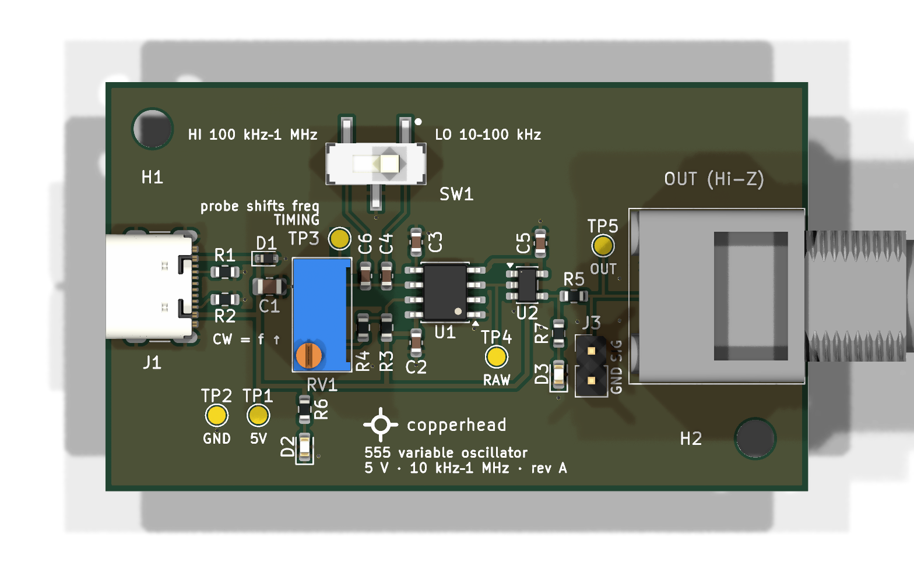
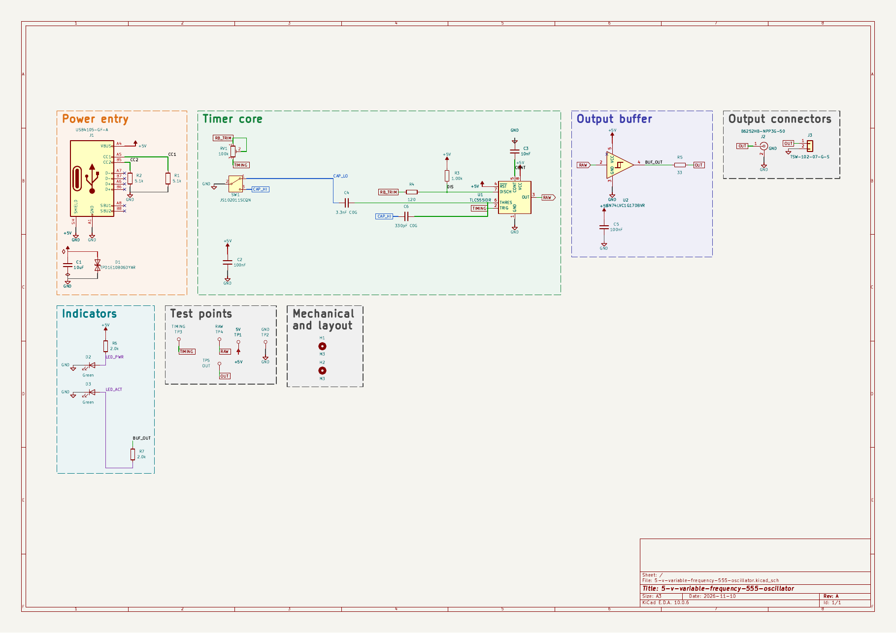
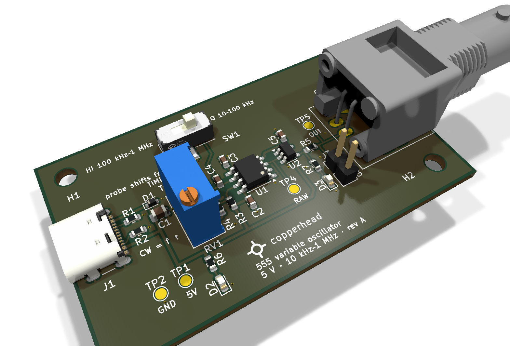

<p>
  
  
</p>

# 5 V Variable-Frequency 555 Oscillator, rev A

A compact bench oscillator. It gives an adjustable square wave from about 10 kHz to 1 MHz, for
an oscilloscope or a 5 V logic input. It is built around the TI TLC555 CMOS timer in astable
mode, followed by an SN74LVC1G17 Schmitt-trigger buffer. It runs from 5 V over USB-C. A
25-turn trimmer sets the frequency, and a slide switch picks one of two overlapping ranges.
The output is on a BNC and a 2-pin header. 60 × 35 mm, two layers, every part on the top.
For high-impedance loads only: no 50 Ω drive is claimed.

> ## ⚠ This board has never been built
>
> - **Never fabricated, never powered.** Nothing here has been tested on real hardware. Until
>   bring-up passes, every number below is a design value, not a measurement.
> - **Bare-PCB release.** Every part in [`docs/BOM.md`](docs/BOM.md) is still marked
>   UNVERIFIED, so rev A has no fab BOM. Assemble it by hand.
> - **The top of the range is at risk.** An ngspice study with TI's TLC555 model puts the
>   worst-case top of the HI range at about 744 kHz with the fitted C4 = 3.3 nF and
>   C6 = 330 pF. C4 = 2.2 nF and C6 = 150 pF reached 1.19 MHz at every corner. Both are 0603
>   C0G parts, so the choice can be made at assembly (see [`fab/rev-a/README.md`](fab/rev-a/README.md)).
> - **Not checked:** parts against datasheets and stock, the gerbers in a viewer, the fab's DFM
>   report, EMC and temperature behaviour.
>
> Passing ERC and DRC means the copper matches the schematic and a rule set. It is not evidence
> that the circuit works.



*Renders, not photographs, with every footprint populated.*

## The circuit

[](docs/schematic.pdf)

- **Power entry:** a GCT USB4105 USB-C receptacle, used for 5 V only. CC1 and CC2 each have
  their own 5.1 kΩ pull-down. A TPD1E10B06 ESD diode and a 10 µF capacitor sit on VBUS. There
  is no regulator and no battery. The budget is below 30 mA.
- **Timer core:** a TLC555 astable with R_A = 1.00 kΩ and R_B = 120 Ω plus a Bourns 3296W
  100 kΩ 25-turn trimmer (RV1), wired as a rheostat.
  - A C&K JS102011SCQN top-slide switch (SW1) picks the timing capacitor: C4 for LO or C6 for
    HI, both C0G.
  - SW1 sits in the capacitors' ground return, so no switch contact touches the timing node.
  - 1 % resistors; 100 nF decoupling at the timer and 10 nF on CONT.
- **Output buffer:** an SN74LVC1G17 Schmitt buffer squares up the timer output, with a 33 Ω
  series resistor to the output. The 33 Ω damps cable ringing. It is not a 50 Ω match.
- **Output connectors:** an Amphenol RF B6252HB right-angle BNC at the right board edge, and a
  Samtec TSW 2-pin header (pin 1 OUT, pin 2 GND).
- **Indicators:** a green power LED, and a green activity LED driven from the buffer output,
  two stages away from the timing node.
- **Test points:** five bare pads, for 5V, GND, TIMING, RAW (timer output) and OUT. The
  silkscreen warns that a probe on TIMING shifts the frequency.

### Frequency ranges

| Range | Switch | Timing C | Worst case, hand calculation | Worst-case top, ngspice |
| --- | --- | --- | --- | --- |
| LO | `LO 10–100 kHz` | C4 3.3 nF | 2.54 kHz to 120.6 kHz | — |
| HI | `HI 100 kHz–1 MHz` | C6 330 pF | 25.4 kHz to 1.206 MHz | about 744 kHz |

The hand calculation is the ideal astable equation at worst-case tolerances (from
[`docs/SUBSYSTEMS.md`](docs/SUBSYSTEMS.md)). It leaves out the TLC555's internal delays, about
370 ns per cycle, which matter near 1 MHz. Within each range, most of the trimmer's travel
tunes the low end, because frequency goes as 1/R.

The design documents are in [`docs/`](docs/):

- [`BRIEF.md`](docs/BRIEF.md): what was asked for.
- [`SPEC.md`](docs/SPEC.md): the specification derived from the brief.
- [`SUBSYSTEMS.md`](docs/SUBSYSTEMS.md): the circuit, block by block, with the timing arithmetic.
- [`PINOUT.md`](docs/PINOUT.md): the connectors and test points.
- [`BOM.md`](docs/BOM.md): every part and its reason. Every MPN is unverified.
- [`DECISIONS.md`](docs/DECISIONS.md): the design's decisions.

### The board

From [`docs/BOARD-STATS.md`](docs/BOARD-STATS.md):

- **Size:** 60 x 35 mm, 1.6 mm thick, two M3 mounting holes.
- **Stackup:** two copper layers. GND pours on both, and the back is an unbroken ground plane
  under the oscillator and output path.
- **Parts:** 30 footprints, all on the top: 20 SMD, 3 through-hole (J2, J3, RV1), and the test
  pads and mounting holes. 23 are parts to fit.
- **Routing:** 18 vias (0.3 mm drill), 15 nets, 68 track segments, all on the top layer,
  0.2 to 0.4 mm wide.



## Layout of this repository

```text
hardware/   KiCad project: schematic, board, design rules, vendored symbols, the SW1 footprint and model
docs/       brief, design documents, board statistics, schematic as PDF and SVG
fab/        gerbers, drill and placement file for rev A (read the README in the folder)
images/     renders of the board, not photographs
3d/         STEP, GLB and STL models
LICENSES/   full text of the licences below
```

## Building it

1. **Open:** use KiCad 10.0.6 or later on
   `hardware/5-v-variable-frequency-555-oscillator.kicad_pro`. The symbols are vendored in
   `hardware/sym-lib-cache/` (through `sym-lib-table`). The SW1 footprint and 3D model are in
   `hardware/lib/` (through `fp-lib-table`). It opens without extra libraries.
2. **Fab files:** read [`fab/rev-a/README.md`](fab/rev-a/README.md) first. The files are the
   rev A release unchanged, and the README lists what has not been checked.
3. **Order bare boards:** two layers, 1.6 mm. Nothing special on the order form.
4. **Parts:** buy them from [`docs/BOM.md`](docs/BOM.md). Check each against its datasheet
   first, because none has been checked yet. Fit the **B6252HB-NPP3G-50** BNC, which is the
   footprint on the board, not the 31-5536-RFX the brief names. Decide C4 and C6 (see above).
5. **Assemble by hand:** the placement file in `fab/rev-a/` gives every part's position and
   rotation. J2, J3 and RV1 are through-hole.

## Licence

| What | Licence |
|---|---|
| Hardware: everything under `hardware/`, `fab/` and `3d/` | **CERN-OHL-S-2.0** (strongly reciprocal) |
| Documentation and images: `docs/`, `images/`, `README.md` | **CC-BY-4.0** |

Full texts are in [`LICENSES/`](LICENSES/). See [`LICENSE`](LICENSE) for the per-directory
statement.

**No warranty.** CERN-OHL-S-2.0 sections 8 and 9 apply: no warranty, no liability.
